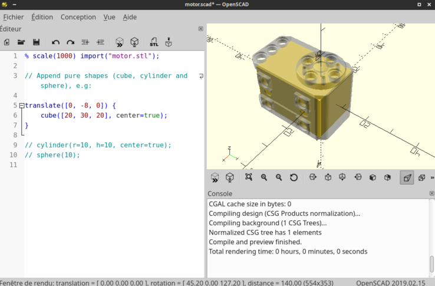

OpenSCAD pure shapes approximation
==================================

Introduction
------------

This processor provides you a way to manually approximate your robot into pure shapes.

You can follow the following `video tutorial <https://www.youtube.com/watch?v=C8oK4uUmbRw>`_. Some of the steps are outdated, but the general idea is still the same.

Requirements
------------

For this processor to work, you need to install the OpenSCAD package:

.. code-block:: bash

    sudo apt-get install openscad

Process
-------

When the OpenSCAD processor is enabled (see below), it will check for the presence of ``.scad`` files in the output directory. If some are present, they will be parsed and pure shapes will be exported.

.. note::
    
    By default, exporters will use pure shapes for collisions instead of meshes.

You can use the following convenient command to run OpenSCAD on a specific ``.stl`` you want to approximate:

.. code-block:: bash

    onshape-to-robot-edit-shape <path_to_stl>

This will open a window similar to the following:

Editing the ``.scad`` file with the same name as the ``.stl`` file. Pure shapes present here will be used as approximation.

The ``.scad`` file can also be generated from sketches drawn in Onshape, in the part studio of the part. Sketches named ``PureShapes <thickness>`` (e.g. ``PureShapes 5.3``, thickness in mm) are extruded below their plane: their circles become cylinders, and their rectangles boxes:

.. code-block:: bash

    onshape-to-robot-pure-sketch <path_to_stl> [prefix] [--quiet]

The optional ``prefix`` replaces ``PureShapes`` in the sketch names, and ``--quiet`` only writes the ``.scad`` file, without opening OpenSCAD.

``config.json`` entries
-----------------------

.. code-block:: javascript

    {
        // ...
        // General import options (see config.json documentation)
        // ...

        // Simplify STL meshes (default: false)
        "use_scads": true,
        // Can be used to enlarge/shrink the pure shapes (default: 0.0)
        "pure_shape_dilatation": 0.0
    }

``use_scads`` *(default: false)*
~~~~~~~~~~~~~~~~~~~~~~~~~~~~~~~~

If set to ``true``, the processor will use OpenSCAD pure shapes approximation (see above)

``pure_shape_dilatation`` *(default: 0.0)*
~~~~~~~~~~~~~~~~~~~~~~~~~~~~~~~~~~~~~~~~~~

A float that can be used to enlarge or shrink the pure shapes. This can be useful to avoid collisions between parts.

Use a negative value to shrink the shapes.